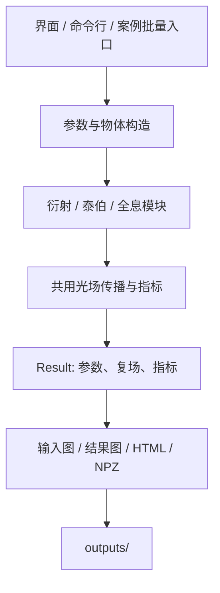

# 架构与目录说明

项目采用一个共用复光场框架、三个实验模块和统一的结果导出。20个具体案例由配置与实验流程组合产生。

## 数据流



`Grid` 保存采样点数、dx、波长与坐标；`Plane` 保存单平面的二维复场与坐标；`Result` 保存整个实验的参数、各平面、辅助数组、指标和说明。

## 源码

| 文件 | 作用 |
|---|---|
| `core.py` | 网格、FFT、LightPipes接口、菲涅耳/角谱/远场传播、功率和采样诊断 |
| `objects.py` | 孔径、图片、光栅、合成靶标、相位屏 |
| `metrics.py` | 相似度、相对误差、相位误差、CDI歧义对齐 |
| `diffraction.py` | 衍射、解析参考、ER/HIO恢复 |
| `talbot.py` | 泰伯、多平面扫描、双光栅及部分相干 |
| `holography.py` | 离轴记录与重建、相移、薄屏补偿 |
| `results.py` | 统一结果容器及NPZ/JSON保存 |
| `reporting.py` | 常规模块图表和HTML报告 |
| `input_visualization.py` | 每次实验的物理输入图、输入振幅/相位图 |
| `input_models.py` | 每个对象的具体透过率与复振幅公式、独立求值及公式图 |
| `workflow_catalog.py` | 20个完整案例及流程大图、分步图表导出 |
| `image_workflows.py` | 自定义照片的衍射与离轴全息完整流程、补零校核、结果对比与原图保存 |
| `validation.py` | 独立物理与收敛验证 |
| `paths.py` | 项目、示例、输出和验证目录的统一默认路径 |
| `cli.py` | 参数解析、配置读取、模块调度 |
| `gui.py` | Tkinter界面、后台计算和预览 |
| `__init__.py` / `__main__.py` | Python接口和模块启动入口 |

## 文档、配置与资源

- `docs/plans/`：三个原始执行方案，归档时保留原内容。
- `docs/numerical-notes.md`：当前实现的FFT约定、采样条件、模型范围和原方案修正。
- `configs/default.json`：默认实验；`phase_and_2d.json`：二维相位光栅及角谱示例。
- `examples/`：示例振幅/相位图片与生成脚本，是模拟输入资源。
- `tests/test_physics.py`：物理和数值约定的回归测试。
- `scripts/launch.ps1`：定位项目根目录、检查环境、启动界面；根目录CMD为双击入口。
- `pyproject.toml`：依赖的统一来源；`requirements.txt`：通过 `-e .` 安装项目；开发依赖在 `dev` 可选组。

## 生成结果

`outputs/workflows/index.html` 是完整案例的汇总入口，案例编号01至20。每例结构如下：

```text
00_全流程图.png / .svg
01_输入图/        物理示意、具体透过率/复振幅公式及原始图片
02_输入复振幅/    振幅、相位、两联图及输入数组
03_计算过程/      方法、频谱、曝光或传播演化
04_输出结果/      传播场、自像、重建或补偿结果
05_验证/          解析对比、残差及指标图
06_数据/          复场NPZ、指标JSON、配置JSON
流程说明.md       流程与重现命令
流程清单.json     图表路径与顺序
index.html        单案例完整浏览入口
```

`outputs/validation/` 保存独立物理和收敛验证。常规模块与界面的运行默认在 `outputs/时间戳/` 保存新结果。

`outputs/image_simulations/图片名/` 保存自定义照片的两个完整流程、结果对比图和计算摘要。`image_workflows.py` 复用现有物体构造、实验模块及全流程导出，照片灰度作为振幅透过率，初始相位设为0。各例复制原照片；衍射额外检查扩大窗口后的变化，全息误差以带限输入为真值。

图表引用案例内相对路径；移动整个案例文件夹不会破坏其内部图表关系。图片案例同时保存原始输入，重绘优先使用当时保存的图片。项目内图片路径在JSON中使用相对路径，便于复制项目。

## 清理约定

根目录原有独立输入图册和早期 `outputs/demo/` 已由完整案例覆盖，过期产物归档于 `outputs/archive/`；独立图册生成入口已移除。每例仍保留独立物理输入与幅相图。

源码、原始方案、配置和示例输入是维护对象；生成结果、虚拟环境、构建产物和运行缓存由 `.gitignore` 排除。`.venv` 保留用于运行；测试缓存放在 `.cache/pytest`。
